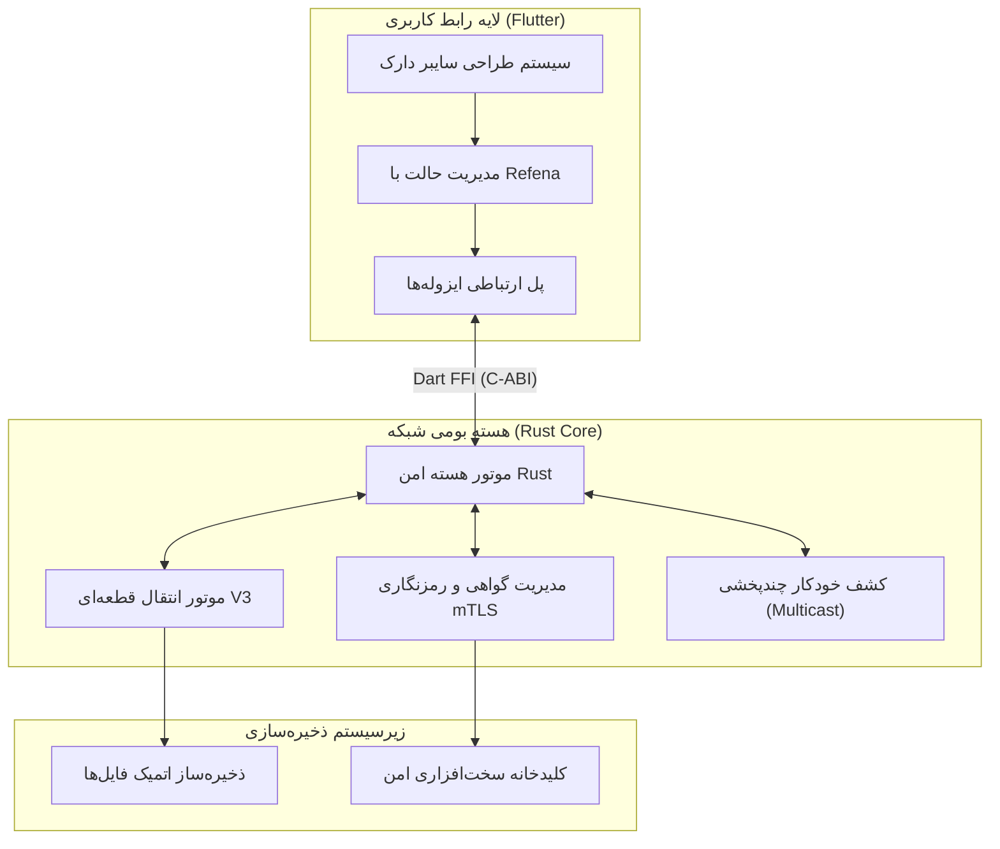

<div align="center">
  
  <h1>مش (Mesh) ⚡</h1>
  <p><strong>نزدیک. فوری. خصوصی. (Nearby. Instant. Private.)</strong></p>
  <p>نرم‌افزار فوق‌سریع، امن و چندپلتفرمه برای انتقال مستقیم فایل و اشتراک کلیپ‌بورد در شبکه محلی بدون نیاز به اینترنت.</p>

  <p>
    <a href="https://flutter.dev"></a>
    <a href="https://www.rust-lang.org"></a>
    
    
  </p>

  <p>
    <a href="#-ویژگی‌های-کلیدی">ویژگی‌های کلیدی</a> •
    <a href="#-معماری-پروژه">معماری پروژه</a> •
    <a href="#-راه‌اندازی-و-توسعه">راه‌اندازی و توسعه</a> •
    <a href="#-مدل-امنیتی">مدل امنیتی</a> •
    <a href="README.md">English Documentation</a>
  </p>
</div>

---

## ⚡ معرفی پروژه

**مش (Mesh)** یک جایگزین مدرن، فوق‌سریع، خصوصی و متن‌باز برای سرویس‌های انحصاری نظیر AirDrop و Quick Share است. این نرم‌افزار به شما امکان می‌دهد انواع فایل، پوشه و متن کلیپ‌بورد را بدون وابستگی به اینترنت، بدون واسطه سرورهای ابری و بدون محدودیت در حجم فایل، مستقیماً از طریق شبکه محلی (Wi-Fi یا LAN) بین دستگاه‌های مختلف جابه‌جا کنید.

نرم‌افزار Mesh با بهره‌گیری از **هسته مقاوم و سریع Rust** در لایه شبکه و سوکت‌ها و فریم‌ورک **Flutter** در لایه کاربری، تجربه کاربری روان (120 FPS) را با بالاترین سرعت انتقال تلفیق کرده است.

---

## ✨ ویژگی‌های کلیدی

- 🛡️ **امنیت کامل بر بستر mTLS:** تمامی داده‌ها و درخواست‌ها با گواهی‌های موقت رمزنگاری شده و دارای تاییدیه بصری **SAS (Short Authentication String)** جهت جلوگیری از حملات مرد میانی (MITM) هستند.
- 🚀 **معماری دو هسته‌ای (Flutter + Rust):** اجرای پردازش‌های سنگین شبکه، هشینگ و جریان داده‌ها در زبان بومی Rust جهت بهره‌مندی از حداکثر پهنای باند شبکه و جلوگیری از قفل شدن UI.
- 🔄 **پروتکل پیشرفته V3 (تکه‌ای و قابل ادامه):** پشتیبانی از قطعه‌بندی فایل‌ها (Chunking)، اعتبارسنجی تمامیت با SHA-256 و قابلیت ادامه انتقال (Resume) پس از قطع ناگهانی شبکه.
- 📋 **کلیپ‌بورد مشترک رمزنگاری‌شده:** همگام‌سازی فوری و یک‌کلیکه متن‌ها بین گوشی، تبلت و کامپیوتر.
- 🎨 **هویت بصری سایبر دارک (Cyber Dark):** طراحی مدرن و شیشه‌ای با تم مشکی سرمه‌ای عمیق، هایلایت‌های آبی الکتریکی و فیروزه‌ای، رادار جستجوی سه‌بعدی و کارت‌های نئونی.
- 🌐 **۱۰۰٪ مستقل از اینترنت:** تمام تبادلات در شبکه محلی شما باقی می‌ماند؛ هیچ ردیاب، تبلیغات یا سرور خارجی در میان نیست.
- 📱 **پشتیبانی کامل از تمام سیستم‌عامل‌ها:**
  - **ویندوز** (نرم‌افزار محلی Win32، منوی کلیک راست SendTo و آیکون System Tray)
  - **اندروید** (پشتیبانی از سرویس پس‌زمینه و کاشی تنظیمات سریع Quick Tile)
  - **آی‌او‌اس و مک** (پشتیبانی از اشتراک‌گذاری سیستمی و منوی بالایی)
  - **لینوکس و وب** (رابط کاربری واکنش‌گرا با قابلیت Drag & Drop فایل‌ها)

---

## 🏗️ معماری پروژه



---

## 🚀 راه‌اندازی و توسعه محلی

### پیش‌نیازها

- [Flutter SDK](https://flutter.dev/docs/get-started/install) (نسخه ۳.۴۱ یا بالاتر)
- [Rust & Cargo](https://rustup.rs/) (نسخه ۱.۸۰ یا بالاتر)

### مراحل اجرا:

```bash
# ۱. دریافت وابستگی‌ها و تست هسته راست
cargo test --workspace

# ۲. ورود به دایرکتوری اپلیکیشن و اجرای تست‌های فلاتر
cd app
flutter test

# ۳. اجرای نرم‌افزار روی دستگاه متصل
flutter run
```

---

## 🔒 مدل امنیتی

1. **ارتباط دوطرفه رمزنگاری‌شده (mTLS):** ارتباط بین فرستنده و گیرنده با گواهی‌های امنیتی موقت محافظت می‌شود.
2. **کد بصری و هش SAS:** کاربران می‌توانند آیکون‌ها و ارقام امنیتی را با دستگاه مقابل تطبیق داده و از عدم شنود اطمینان یابند.
3. **محافظت در برابر Path Traversal:** نام فایل‌ها و مسیرهای ورودی پالایش می‌شوند تا هیچ فایلی خارج از پوشه مقصد دانلود ایجاد نشود.
4. **تأییدیه هش تکه‌ها:** هر تکه فایل با الگوریتم SHA-256 ارزیابی شده و فایل‌های ناقص هرگز ذخیره نمی‌شوند.

---

## 📄 مجوز انتشار

این نرم‌افزار تحت مجوز عمومی گنو نسخه ۳ (GPLv3) منتشر شده است.
جهت اطلاعات بیشتر فایل [LICENSE](LICENSE) را مشاهده کنید.
