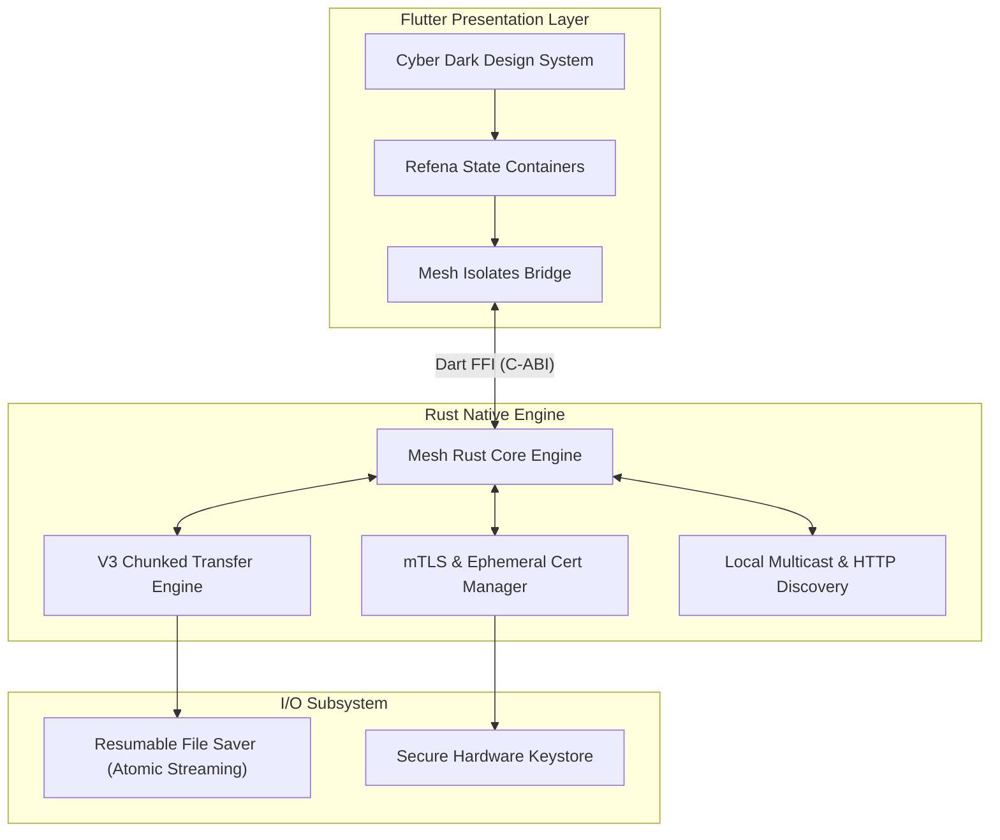

<div align="center">
  
  <h1>Mesh</h1>
  <p><strong>Nearby. Instant. Private.</strong></p>
  <p>An ultra-fast, encrypted, and cross-platform peer-to-peer file sharing and shared clipboard application for local networks.</p>

  <p>
    <a href="https://flutter.dev"></a>
    <a href="https://www.rust-lang.org"></a>
    
    
    
  </p>

  <p>
    <a href="#-key-features">Key Features</a> •
    <a href="#-architecture">Architecture</a> •
    <a href="#-getting-started">Getting Started</a> •
    <a href="#-security-model">Security Model</a> •
    <a href="MESH-README-FA.md">راهنمای فارسی</a>
  </p>
</div>

---

## ⚡ Overview

**Mesh** is an open-source, peer-to-peer file transfer and shared clipboard utility designed to replace proprietary protocols like AirDrop and Quick Share. It allows you to share files, folders, and text messages directly between any of your devices over your local Wi-Fi or LAN—without internet access, cloud servers, or file size limits.

Built with a high-performance **Rust Core** networking engine and a reactive **Flutter** front-end, Mesh combines multi-gigabit throughput with a modern, glassmorphic **Cyber Dark** UI.

---

## ✨ Key Features

- 🛡️ **Zero-Knowledge Local Security:** All communication is secured via on-the-fly TLS 1.3 / mTLS certificates with visual **Short Authentication String (SAS)** verification badges.
- 🚀 **Dual-Engine Performance:** Critical socket I/O, hashing, and protocol serialization run on an optimized native **Rust Core**, while the interface runs at 120 FPS on **Flutter**.
- 🔄 **Chunked & Resumable (V3 Protocol):** Automatic SHA-256 integrity verification, parallel chunked transfers, and seamless transfer resumption across network drops.
- 📋 **Universal E2EE Shared Clipboard:** 1-tap synchronized clipboard sharing across all connected phones, tablets, and desktop workstations.
- 🎨 **Cyber Dark Design System:** Premium dark aesthetic featuring Deep Navy, Electric Blue, and Aurora Cyan accents, circular 3D radar pulse discovery, and tactile glass cards.
- 🌐 **100% Offline & Private:** Operates strictly on your local network (LAN / Wi-Fi). No telemetry, no external trackers, no accounts.
- 💻 **True Cross-Platform Parity:**
  - **Windows** (Native Win32 runner with system tray & SendTo integration)
  - **Android** (Material / Cyber adaptive, background service, Quick Tile)
  - **iOS & macOS** (AirDrop alternative with native share sheet & menu bar integration)
  - **Linux & Web** (Responsive interface with desktop dropping)

---

## 🏗️ Architecture

Mesh separates UI responsibilities from core networking to guarantee zero UI freezes:



---

## 🚀 Getting Started

### Prerequisites

- [Flutter SDK](https://flutter.dev/docs/get-started/install) (^3.41.0)
- [Rust & Cargo](https://rustup.rs/) (1.80+)

### Local Development

1. **Clone the repository:**
   ```bash
   git clone https://github.com/<your-username>/mesh.git
   cd mesh
   ```

2. **Run tests across workspace:**
   ```bash
   # Test Rust Core
   cargo test --workspace

   # Test Flutter Application
   cd app
   flutter test
   ```

3. **Launch the application:**
   ```bash
   cd app
   flutter run
   ```

---

## 🔒 Security Model

1. **Mutual TLS (mTLS):** Connections between peers are mutually authenticated and encrypted with on-the-fly generated certificates.
2. **Visual SAS Fingerprints:** Peers can visually verify Short Authentication String (SAS) icons or hex fingerprints to eliminate Man-In-The-Middle (MITM) risks.
3. **Directory Traversal Protection:** All incoming paths are sanitized to prevent escape attacks (`../`) outside the configured downloads directory.
4. **Resumable Integrity:** File chunks are hashed and validated with SHA-256 before final commitment.

---

## 📄 License

This project is licensed under the terms of the GNU General Public License v3.0 (GPLv3).
See [LICENSE](LICENSE) for details.
