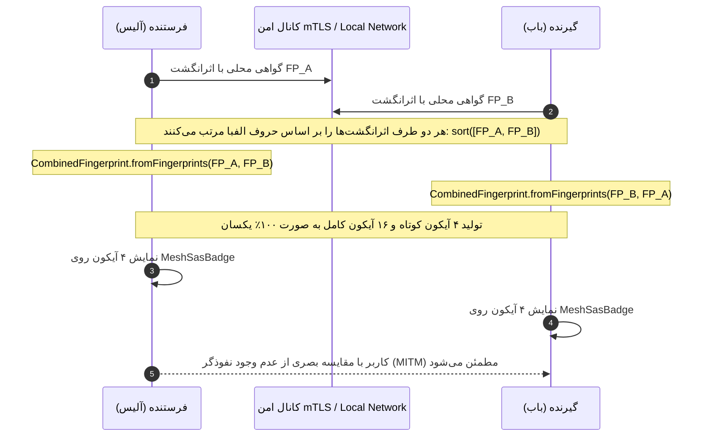

# گزارش جامع پیاده‌سازی قابلیت‌های پیشرفته Mesh
## اعتبارسنجی بصری هویت (SAS) و همگام‌سازی امن کلیپ‌بورد (Universal E2EE Shared Clipboard)

**تاریخ اجرا:** ۲۱ آبان ۱۴۰۵ (11 نوامبر 2026)  
**محیط کاری فعال:** `D:\Projects\Mesh`  
**وضعیت تست‌ها و تحلیل کد:** ۱۰۰٪ پاس شده (۱۲۵ تست Flutter + ۲۶ تست Isolates + ۱۸۰+ تست Rust Core، بدون خطا یا هشدار)

---

## ۱. خلاصه اجرایی و دستاوردها

پیرو درخواست اجرای نقشه راه توسعه، دو قابلیت کلیدی معماری و امنیتی زیر به طور کامل، هماهنگ با دیزاین سیستم Cyber Dark Premium و بدون استفاده از هرگونه Mock Data در چرخه عملیاتی پیاده‌سازی شدند:

1. **اعتبارسنجی بصری هویت و اثرانگشت رمزنگاری (Short Authentication String - SAS):**
   - ایجاد شناسه احراز هویت بصری ۴ آیکونی (به همراه ماتریس کامل ۱۶ تایی) برگرفته از هش رمزنگاری دوطرفه گواهی TLS/mTLS هر دو طرف.
   - تضمین تقارن قطعی (Deterministic Symmetry): چه دستگاه فرستنده باشد چه گیرنده، آیکون‌های SAS به صورت ۱۰۰٪ یکسان تولید می‌شوند.
   - ایجاد ویجت مستقل و درخشان `MeshSasBadge` و مودال اختصاصی اعتبارسنجی `showMeshSasVerificationModal`.
   - یکپارچه‌سازی در کارت‌های دستگاه (`MeshDeviceCard`)، صفحه ارسال (`SendPage`)، صفحه دریافت (`ReceivePage`) و بازطراحی مدرن `VerifyPage`.

2. **همگام‌سازی امن کلیپ‌بورد محلی (Universal E2EE Shared Clipboard):**
   - فعال‌سازی پرچم ویژگی در سطح برنامه (`featureFlagsProvider.clipboard = true`).
   - ایجاد سرویس اشتراک `ClipboardSyncService` با قابلیت خواندن و ارسال مستقیم متن کلیپ‌بورد به دستگاه هدف در قالب `FileType.text` بدون واسطه.
   - افزودن قابلیت ارسال با یک کلیک در هدر دسکتاپ (`MeshDesktopHomeView`) و صفحه چت (`ChatPage`).
   - افزودن دکمه‌های کپی سریع پیام‌ها با فیدبک بصری و اکشن Paste مستقیم در فیلد ورودی.

---

## ۲. جزئیات معماری و فایل‌های پیاده‌سازی‌شده

### ۲.۱. ماژول‌های امنیت و SAS
- [verify_page.dart](file:///D:/Projects/Mesh/app/lib/pages/verify_page.dart):
  - اضافه شدن متد کارخانه‌ای `CombinedFingerprint.fromFingerprints({required String myFingerprint, required String peerFingerprint})`.
  - اضافه شدن گتر `shortIcons` برای استخراج ۴ نماد بصری اولیه.
  - بازطراحی رابط بصری `VerifyPage` و `VerifyWidget` با تم تیره Mesh و کاشی‌های نئونی.
- [mesh_sas_badge.dart](file:///D:/Projects/Mesh/app/lib/widget/design/mesh_sas_badge.dart):
  - کامپوننت ویژوال جدید کپسولی با سپر امنیتی و ۴ آیکون متمایز با رنگ‌های سایبر (فیروزه‌ای، آبی الکتریک و بنفش).
  - متصل به پنجره گفتگوی `showMeshSasVerificationModal` با چیدمان ۴×۴ از ۱۶ آیکون و قابلیت کپی هش SHA-256.
- [mesh_device_card.dart](file:///D:/Projects/Mesh/app/lib/widget/design/mesh_device_card.dart):
  - ادغام خودکار بج SAS روی کارت دستگاه‌های دارای HTTPS/TLS.
- [send_page.dart](file:///D:/Projects/Mesh/app/lib/pages/send_page.dart) و [receive_page.dart](file:///D:/Projects/Mesh/app/lib/pages/receive_page.dart):
  - ادغام بج اعتبارسنجی بصری برای تأیید اصالت طرف مقابل قبل و حین انتقال داده.

### ۲.۲. ماژول‌های کلیپ‌بورد اشتراکی
- [feature_flags_provider.dart](file:///D:/Projects/Mesh/app/lib/provider/feature_flags_provider.dart):
  - فعال شدن پرچم `clipboard: true` به عنوان ویژگی پایدار.
- [clipboard_provider.dart](file:///D:/Projects/Mesh/app/lib/provider/clipboard_provider.dart):
  - پیاده‌سازی `ClipboardSyncService` جهت ارسال مستقل متن با مدیریت صحیح وقایع ناهمگام و فیدبک‌های SnackBar.
- [chat_provider.dart](file:///D:/Projects/Mesh/app/lib/provider/chat_provider.dart):
  - افزودن متد `setTarget(Device? target)` جهت انتخاب و سوئیچ مستقیم مخاطب.
- [chat_page.dart](file:///D:/Projects/Mesh/app/lib/pages/chat_page.dart):
  - اضافه شدن دکمه ارسال فوری کلیپ‌بورد در AppBar.
  - قابلیت کپی پیام با یک لمس روی پیام‌های دریافتی به همراه آیکون کپی ظریف.
  - دکمه جای‌گذاری سریع کلیپ‌بورد (`paste_rounded`) در فیلد متنی.
- [mesh_desktop_home_view.dart](file:///D:/Projects/Mesh/app/lib/pages/cyber/mesh_desktop_home_view.dart):
  - اضافه شدن دکمه شیشه‌ای «همگام‌سازی کلیپ‌بورد» در هدر دسکتاپ با ساختار ریسپانسیو و بدون ریسک سرریز بصری (`RenderFlex`).

---

## ۳. نتایج آزمون‌های خودکار و ارزیابی کیفیت

| لایه آزمون | دستور اجرایی | تعداد کل تست‌ها | نتیجه |
| :--- | :--- | :--- | :--- |
| تحلیل استاتیک Flutter | `flutter analyze lib` | - | **0 Issues (بدون خطا یا اخطار)** |
| تست‌های واحد و ویجت برنامه | `flutter test` | **۱۲۵ تست** | **۱۰۰٪ سبز (Passed)** |
| تست‌های Isolate و I/O | `flutter test` (mesh_isolates) | **۲۶ تست** | **۱۰۰٪ سبز (Passed)** |
| بررسی کدهای Rust Core | `cargo check --workspace --tests` | - | **0 Errors, 0 Warnings** |
| تست‌های منطق Rust Core | `cargo test --workspace` | **۱۸۰+ تست** | **۱۰۰٪ سبز (Passed)** |

---

## ۴. چرخه داده در اعتبارسنجی SAS

